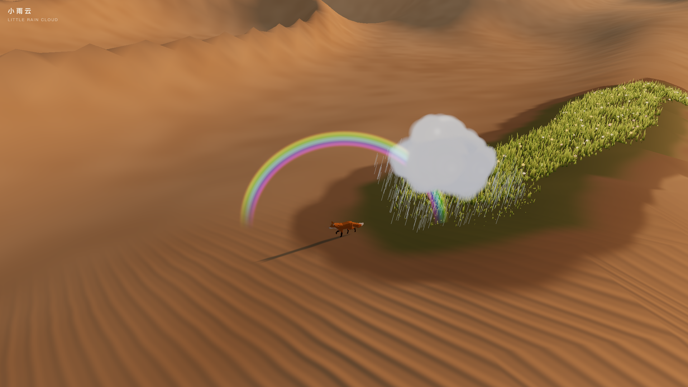
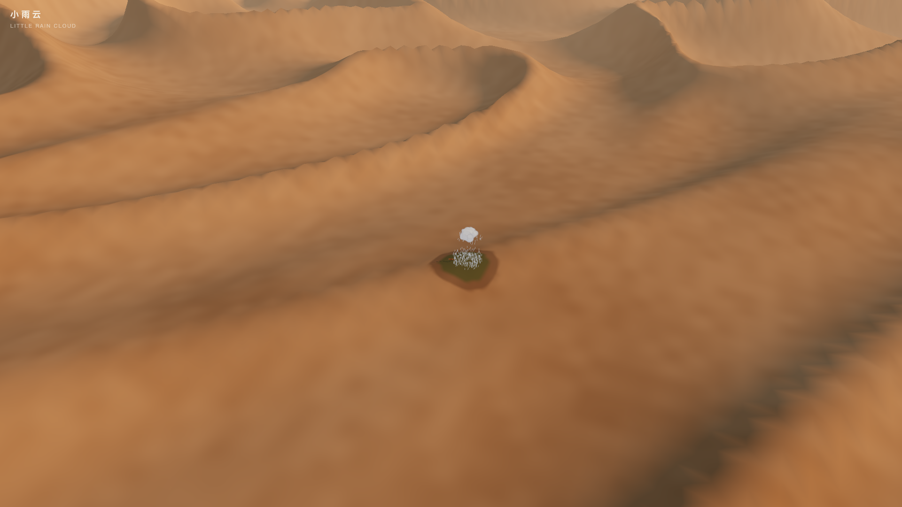
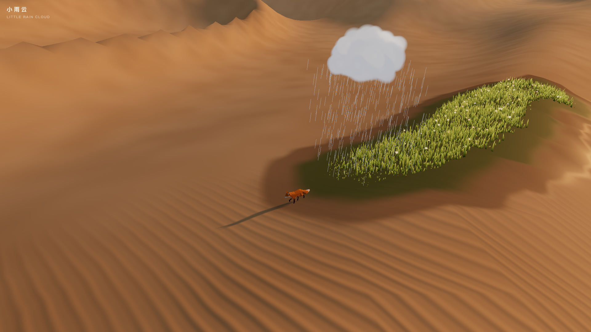
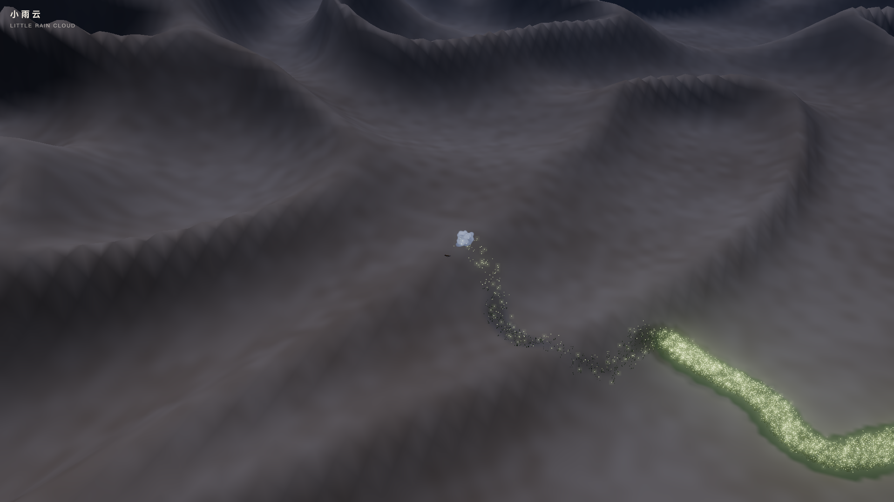

# 小雨云 · Little Rain Cloud



一只小狐狸走过沙漠，头顶跟着一朵只属于它的小雨云。雨落到哪里，哪里就长草、开花；按 C 拉开镜头，就能看到你在荒漠里走出的一条绿色的河。

A fox walks across the desert under a rain cloud that only rains on it. Wherever the rain lands, grass and flowers grow. Press C to pull the camera back and see the green river you walked into the sand.

这是一个可以玩的网页小游戏：three.js 实时渲染，只有一个页面，不需要构建。代码由 Claude Opus 5.5 在 Claude Code 里编写。

A playable web demo: real-time three.js, one page, no build step. Code written by Claude Opus 5.5 in Claude Code.

宣传片 / Trailer：见 [Releases](../../releases)。

## 运行 · Run

```bash
node serve.mjs
```

用 Chrome 打开 http://127.0.0.1:8765 。需要联网，因为 three.js 和狐狸模型从 jsDelivr CDN 加载。点一下画面就会开启声音。

Open http://127.0.0.1:8765 in Chrome. An internet connection is needed: three.js and the fox model load from the jsDelivr CDN. Click once to enable sound.

本仓库只是静态文件，`serve.mjs` 是一个零依赖的本地服务器，换成任何静态服务器都可以。

These are plain static files; `serve.mjs` is a zero-dependency local server, and any static server works.

## 操作 · Controls

| 按键 Key | 作用 | Action |
|---|---|---|
| W A S D | 行走 | Walk |
| Shift | 奔跑（小云会追不上） | Run (the cloud falls behind) |
| 点击地面 Click | 走到那里 | Walk to that spot |
| 拖动 / 滚轮 Drag / Wheel | 环绕镜头 / 远近 | Orbit / zoom |
| E | 呼唤小云，雨里出现彩虹 | Call the cloud; a rainbow appears |
| R | 昼夜切换，夜里雨变成萤火虫 | Day / night; at night the rain turns into fireflies |
| G | 一阵风 | A gust of wind |
| C | 回望来路 | Look back at your trail |
| V | 录制视频（webm，带声音） | Record video (webm with sound) |
| M | 声音开关 | Sound on / off |
| 1 2 3 | 画质 | Quality |
| H | 隐藏面板 | Hide panel |

## 截图 · Screenshots

| | |
|---|---|
|  |  |
|  |  |

## 怎么做的 · How it works

- **地形与沙纹**：用噪声函数生成沙丘，沙面的风纹在着色器里实时计算。
- **雨与生长**：每一滴雨落地时，会在一张 512×512 的「湿度图」上留下痕迹。湿的地方沙子变深，并长出草和花（实例化渲染，最多 18 万根草）。
- **夜晚**：雨换成萤火虫，走过的草地里也会升起萤火。
- **声音**：雨声、风声、虫鸣都用 Web Audio 实时合成；每开一朵花，就响一个五声音阶的音。

- **Terrain**: noise-generated dunes, with wind ripples computed in the shader.
- **Rain and growth**: every raindrop writes into a 512×512 wetness map; wet sand darkens and grows instanced grass and flowers (up to 180k blades).
- **Night**: rain turns into fireflies, and fireflies rise from the grass you grew.
- **Sound**: rain, wind and crickets are synthesized live with Web Audio; every flower that opens rings a pentatonic note.

## 演示与录制参数 · Demo and recording parameters

| 参数 Parameter | 作用 | Effect |
|---|---|---|
| `?auto=1` | 狐狸自己走 | The fox walks on its own |
| `&night=` `&cine=` `&gust=` `&call=`（秒 seconds） | 在指定秒数触发夜晚 / 回望 / 阵风 / 呼唤 | Trigger night / look-back / gust / call at a time |
| `&clean=1` | 隐藏界面 | Hide the UI |
| `&freeze=`（秒 seconds） | 模拟到该秒后停住，用于无头截图 | Simulate to that time and stop (headless screenshots) |
| `&cover=day\|night` | 封面模式 | Cover mode |
| `?director=1` | 30 秒脚本化演示，用于逐帧录制宣传片 | 30 s scripted tour for frame-by-frame trailer recording |

逐帧录制宣传片（需要本机安装 Chrome、Python 的 numpy 和 scipy，以及 ffmpeg）：

Record the trailer frame by frame (needs Chrome, Python with numpy and scipy, and ffmpeg):

```bash
node tools/record.mjs "http://127.0.0.1:8765/?director=1" /tmp/xyy_frames 30 30
python3 tools/mix_audio.py /tmp/xyy_frames/audio_log.json /tmp/xyy_frames/audio.wav 30
ffmpeg -framerate 30 -i /tmp/xyy_frames/f_%04d.jpg -i /tmp/xyy_frames/audio.wav -c:v libx264 -crf 17 -pix_fmt yuv420p -c:a aac -b:a 192k -shortest little-rain-cloud.mp4
```

`tools/record.mjs` 通过 Chrome DevTools Protocol 驱动无头 Chrome，每帧截一张图；`tools/mix_audio.py` 根据录制时记下的事件日志离线合成声音。`tools/covers.sh` 用来渲染社交媒体封面。

`tools/record.mjs` drives headless Chrome over the DevTools Protocol and captures one screenshot per frame; `tools/mix_audio.py` synthesizes the soundtrack offline from the recorded event log. `tools/covers.sh` renders social media covers.

## 换成自己的模型 · Use your own model

把 `main.js` 顶部的 `FOX_URL` 换成任意带骨骼动画的 glb。代码按动画名找 `Survey`（站立）、`Walk`、`Run` 三段，如果你的模型动画名不同，改 `setAnim` 里的名字即可。

Point `FOX_URL` at the top of `main.js` to any rigged glb. The code looks for animation clips named `Survey` (idle), `Walk` and `Run`; rename them in `setAnim` if yours differ.

## 素材与授权 · Credits and license

- 代码：Apache License 2.0，见 [LICENSE](LICENSE)。
- 狐狸模型：来自 [KhronosGroup/glTF-Sample-Assets](https://github.com/KhronosGroup/glTF-Sample-Assets/tree/main/Models/Fox)，运行时从 CDN 加载，**不包含在本仓库里**。模型作者 PixelMannen（CC0），绑骨与动画 tomkranis（CC BY 4.0），glTF 转换 AsoboStudio、scurest（CC BY 4.0）。
- [three.js](https://threejs.org/) 0.170.0（MIT），运行时从 CDN 加载。
- 地形、沙纹、草、花、云、雨、萤火虫、彩虹和全部声音都由代码生成，没有其他外部素材。

- Code: Apache License 2.0, see [LICENSE](LICENSE).
- Fox model: from [KhronosGroup/glTF-Sample-Assets](https://github.com/KhronosGroup/glTF-Sample-Assets/tree/main/Models/Fox), loaded from a CDN at runtime and **not included in this repository**. Model by PixelMannen (CC0), rigging and animation by tomkranis (CC BY 4.0), glTF conversion by AsoboStudio and scurest (CC BY 4.0).
- [three.js](https://threejs.org/) 0.170.0 (MIT), loaded from a CDN at runtime.
- Terrain, sand ripples, grass, flowers, cloud, rain, fireflies, rainbow and all sounds are procedural; no other external assets.

## 已知不足 · Known limitations

- 远处沙丘的脊线有锯齿。 / Distant dune ridges show some aliasing.
- 示例狐狸是低多边形模型，近看棱角明显。 / The sample fox is low-poly and looks faceted up close.
- 只在 macOS 的 Chrome 上测试过。 / Tested only in Chrome on macOS.
